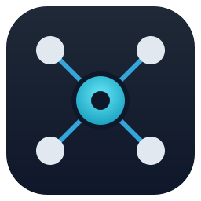
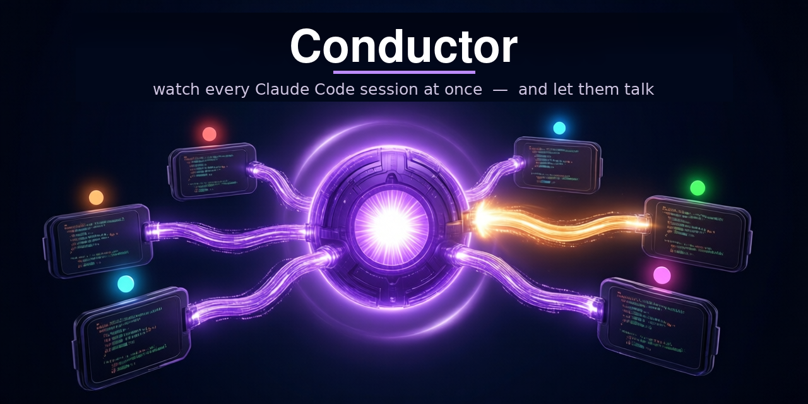
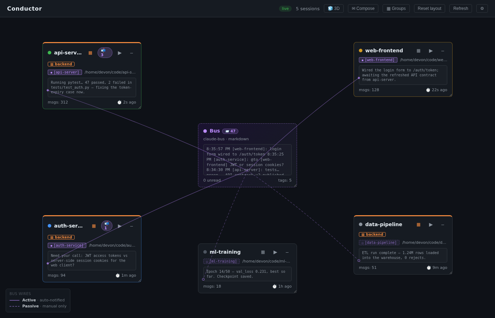
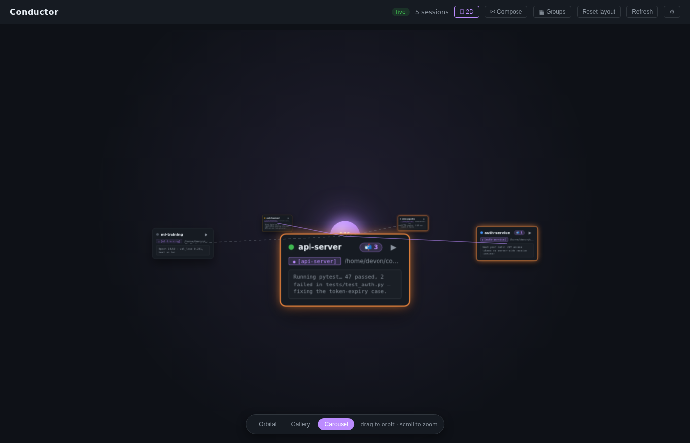
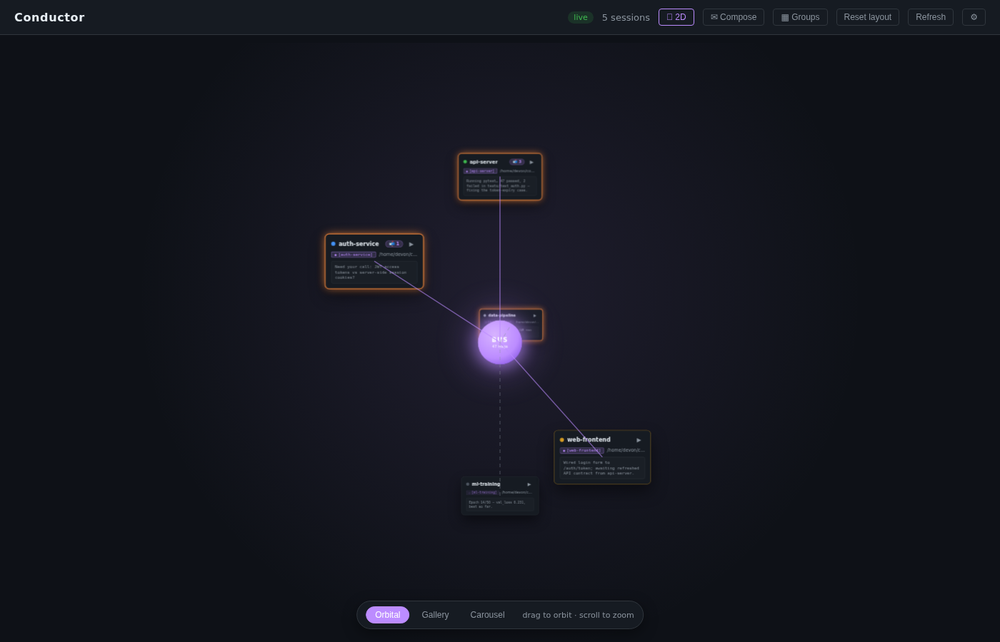
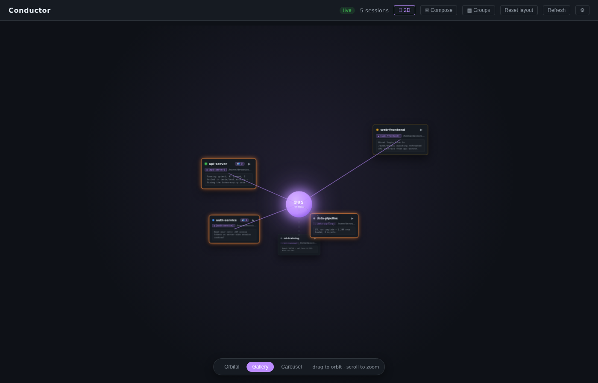
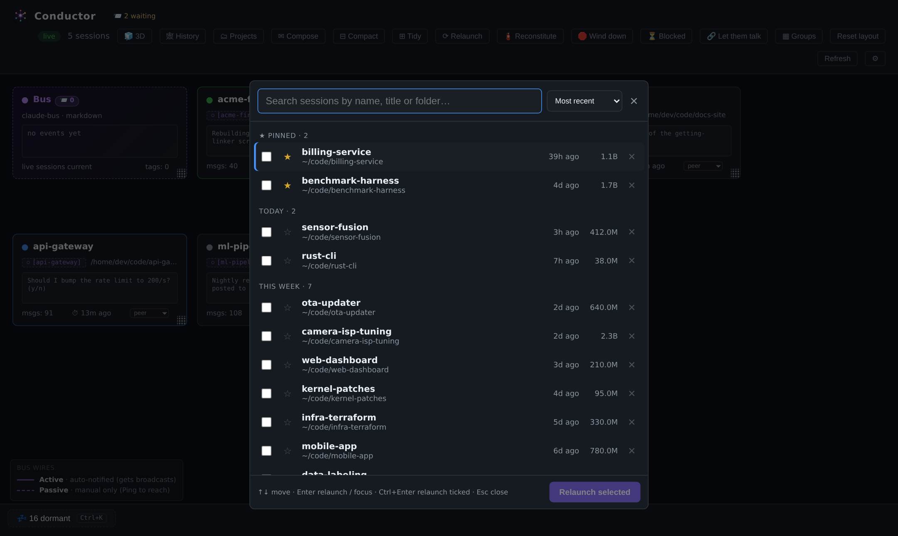
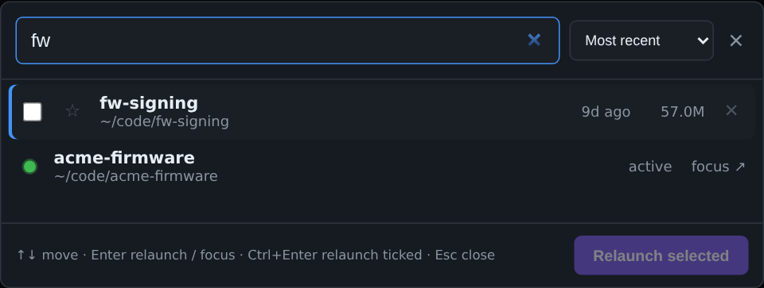
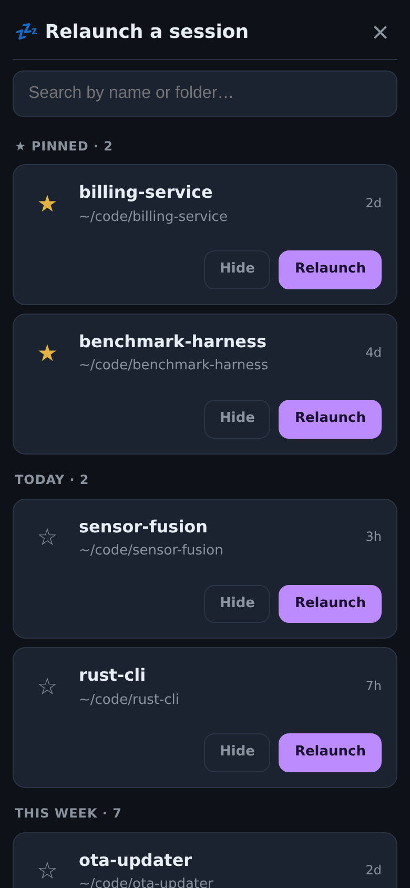
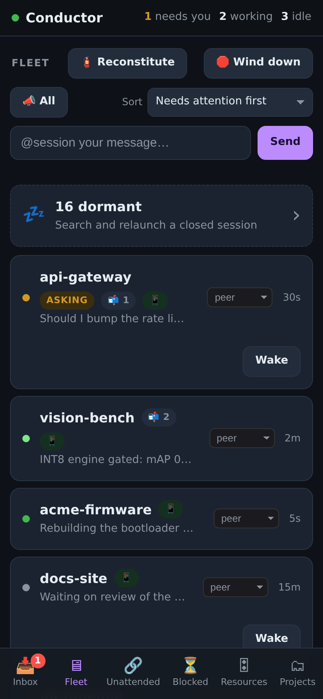

# Conductor

**Conductor is a local web dashboard — and optional desktop app — that shows every Claude Code session on your Linux machine as a live tile, plus an optional message bus that lets those sessions talk to each other.**

[](docs/CHANGELOG.md)
[](#requirements)
[](#privacy-and-safety)
[](LICENSE)

<p align="center">
  
</p>

**For** anyone running several Claude Code sessions at once who keeps losing track of which terminal is doing what, misses the moment one goes quiet, or wants them to coordinate. Runs on `127.0.0.1`, reads Claude's own logs, and never edits your files or conversations.

- [Quick start](#quick-start) · [What it does](#what-it-does) · [Session launcher](#-session-launcher) · [Wire up the bus](#wire-up-the-bus-optional) · [Phone](#phone-access) · [Configuration](#configuration) · [Troubleshooting](#troubleshooting)
- Deeper docs: [Using the dashboard](docs/USING.md) · [Native app & phone setup](docs/INSTALL.md) · [Bus](bus/README.md) · [Changelog](docs/CHANGELOG.md)

---

## Quick start

Tested on **Ubuntu 22.04** with Python 3.10. You need [Claude Code](https://docs.claude.com/en/docs/claude-code/overview) installed.

```bash
sudo apt install git python3-venv python3-pip wmctrl xdotool   # wmctrl/xdotool: click-to-focus + 📬 (optional)
git clone https://github.com/kylefoxaustin/claude-connect
cd claude-connect
python3 -m venv .venv && source .venv/bin/activate
pip install -e .                                                # ".[dev]" adds the test tooling
make dev                                                        # → http://127.0.0.1:8765
```

Open **http://127.0.0.1:8765**, then start a Claude Code session in another terminal. Its tile appears a few seconds after the session's first reply. No registration, no config — `settings.toml` is optional (copy `settings.example.toml` when you want to change something).

- `make run` — the same without auto-reload · `PORT=9000 make dev` — another port
- `make test` — the test suite (needs `pip install -e ".[dev]"`)
- Prefer a desktop window to a browser tab? See the [native app](docs/INSTALL.md#native-app-edition-ubuntu).

---

## What it does



<sub>One tile per live session, a central **Bus** tile, and wires showing cross-session traffic (solid = active, dashed = passive). *Sample data.*</sub>

| | |
|---|---|
| 🪟 **Live tiles** | Every running Claude session, auto-discovered: status, live preview, time since last activity, tokens used. Drag, resize, group, minimize. |
| 🎯 **Click to focus** | Click a tile to raise that session's terminal — the exact tab on [Tilix](https://gnunn1.github.io/tilix-web/). |
| 🚀 **[Session launcher](#-session-launcher)** | Search every closed session and relaunch it where it left off — on the desktop or your phone. |
| 📬 **[Message bus](#wire-up-the-bus-optional)** | Sessions `/msg-send` each other across projects; idle sessions are woken for mail addressed to them. |
| 🔐 **Push & persistence gates** | Hold every `git push`, and every write that outlives a session (hooks, systemd units, `~/.claude/bin`), until you approve it with one tap. [Details](docs/USING.md#-the-two-hard-controls--push-gate--persistence-gate). |
| 📱 **[Phone console](#phone-access)** | A purpose-built mobile view over your own Tailscale tailnet: answer a Claude's question, approve a push, relaunch a session, get paged when one is blocked. |
| 🎛 **Shared resources** | Sessions reserve a GPU or a dev board over the bus, with a queue and an idle watchdog. [Details](docs/USING.md#-shared-resource-coordination). |
| 🩺 **Fleet health** | Flags two sessions colliding in one repo, a reader that went silent, a session that lost its remote control. [Details](docs/USING.md#-fleet-health-signals). |
| 🧊 **3D & 🕸 History** | Flip the board into WebGL, or replay your whole cross-session history as an animated graph. [Details](docs/USING.md#-3d-view). |
| 🧯 **Disaster recovery** | Optional off-box backup of the coordination layer and a one-screen rebuild. [Details](docs/USING.md#disaster-recovery). |

### …or flip to 3D

A **🧊 3D** button swaps the board into a WebGL scene where your sessions float around a glowing bus core, grouped sessions cluster together, and you orbit/zoom the whole thing. Three layouts — pick by feel:

| Carousel *(default)* | Orbital | Gallery |
| :---: | :---: | :---: |
|  |  |  |
| Spin through sessions; the front card is focused and fully readable. | Sessions orbit the bus core on a sphere; groups share an arc. | Your saved 2D positions, lifted into depth; groups clump together. |

<sub>Cards always face the camera, so text stays readable at any angle. 2D stays the default — 3D is one click away. *Sample data shown.*</sub>

---

## 🚀 Session launcher

Closed sessions don't disappear. The dock at the bottom of the board shows one button, **💤 N dormant `Ctrl+K`**; press it (or **Ctrl+K**, or **/**) and a search box opens over every session Conductor has seen. Type a few letters, press **Enter**, and that session reopens with `claude --continue` in its original folder — right where you left off.



- **Search finds running sessions too** — Enter on one of those brings its terminal to the front instead.
- **★ Pin** the projects you return to; **✕ Hide** the ones you won't (recoverable, and a search still finds them).
- **Tick several and relaunch them together** after a reboot — staggered, so the box isn't stampeded.
- **The same launcher is on your phone**, and pins and hides **sync** between the desktop, the native app and the phone.

| Search finds dormant *and* live sessions | On the phone (`/m` → Fleet) |
| :---: | :---: |
|  |  |

<sub>*Sample data.* More — the relaunch keystrokes, the `[relaunch]` settings — in [docs/USING.md](docs/USING.md#-session-launcher--find-and-relaunch-a-closed-session).</sub>

---

## Requirements

- **Linux with X11** (Wayland is best-effort) and **Python 3.10+** with `venv` (`python3-venv` on Ubuntu)
- **Claude Code** — the bus hooks use `SessionStart`, `UserPromptSubmit` and `PreToolUse`
- *Optional:* **`wmctrl` + `xdotool`** for click-to-focus and typing `/msg-check` · **[Tilix](https://gnunn1.github.io/tilix-web/)** for exact-tab focus (`gdbus`, from `libglib2.0-bin`) · **`nvidia-smi`** for the GPU tile · **[Tailscale](https://tailscale.com)** for phone access
- *Native app only:* system WebKitGTK — see [docs/INSTALL.md](docs/INSTALL.md#native-app-edition-ubuntu)

---

## Wire up the bus (optional)

Conductor works fully without it — tiles, focus, the launcher. The bus adds messaging between sessions: a shared markdown log that sessions append to with `/msg-send` and read with `/msg-check`, made visible by hooks. Run this **from a plain terminal**, not from inside a Claude session (the persistence gate blocks these writes from a session, by design):

```bash
install -Dm755 bus/bus.sh ~/.claude/bin/bus.sh
mkdir -p ~/.claude/commands && cp bus/commands/*.md ~/.claude/commands/   # the slash commands
sed "s|/home/YOU|$HOME|g" bus/settings.hooks.example.json                 # merge the output into ~/.claude/settings.json
```

- If your repos don't live under `~/Documents/GitHub` (the default), `export BUS_PROJECTS_ROOT=~/code` (or wherever) so each session gets a clean tag.
- Restart open Claude sessions so they load the hooks, then check: `~/.claude/bin/bus.sh send "hello" && ~/.claude/bin/bus.sh check`.

Full guide — tags, resource reservation, agentic orders, the message format: [`bus/README.md`](bus/README.md) · [`docs/claude-bus.md`](docs/claude-bus.md). A session that isn't on the bus still gets a normal tile; it just has no 📬 badge or wire.

---

## Phone access

The server never leaves `127.0.0.1`; [Tailscale](https://tailscale.com)'s `serve` proxies it onto *your own* tailnet, so only your devices can reach it.

```bash
sudo tailscale set --operator=$USER                      # one-time
tailscale serve --bg --https=443 http://127.0.0.1:8765
```

Then open `https://<host>.<tailnet>.ts.net/m` on your phone (needs MagicDNS and HTTPS certificates enabled in the Tailscale admin console). Set `[server].auth_token` in `settings.toml` once it's reachable. Notifications, the token, and the PWA: [docs/INSTALL.md](docs/INSTALL.md#phone-access--notifications).

| The phone console | |
| :---: | :--- |
|  | **Not the board shrunk down** — a console built for the 30-second "does anything need me?" glance: sessions sorted by what needs you, a decision queue to answer a Claude's question, a push-approval inbox, and the launcher. It pages you on exactly two things — a session blocked on a question, and a `git push` waiting for you. *Sample data.* |

---

## Configuration

`settings.toml` (copy from `settings.example.toml`; every key has a default). `make dev`/`make run` take the port from `PORT=`; the native app and the `conductor` command read `[server].port`.

| Setting                       | What it does                                                  | Default |
| ----------------------------- | ------------------------------------------------------------- | ------- |
| `scanner.interval_seconds`    | Full rescan cadence                                           | `3`     |
| `bus.adapter`                 | `markdown` (the reference bus), `jsonl` (generic), or `fake`  | —       |
| `bus.markdown_path`           | Path to the bus log                                           | `~/Documents/claude-bus/messages.md` |
| `bus.state_dir`               | Where unread state lives                                      | —       |
| `bus.script_path`             | Path to `bus.sh`                                              | —       |
| `bus.sender_tag`              | Your tag when you **Compose** a message (e.g. your name)      | `operator` |
| `[bus.tags]`                  | Map a project dir → bus tag, mirroring your `bus.sh` (labels tiles **and** keys the 🕸 History human layer to the right node) | — |
| `ui.end_fadeout_seconds`      | How long ended-session tiles linger after exit                | `30`    |
| `[relaunch]`                  | After a relaunch: `rc` auto-runs `/rc` (remote control, **on**), `rename` re-issues `/rename` (**off**), plus timing knobs | `rc=true` · `rename=false` |

---

## Privacy and safety

It's **local by default, and read-only toward Claude** — it watches Claude's `~/.claude/projects/*.jsonl` logs and process state, and never edits your files or conversations. The server binds only to `127.0.0.1`, with **no telemetry, no analytics, and no uploads of your data.**

The only things that ever leave the box are ones you explicitly opt into: the 3D view fetches Three.js from a CDN; **phone notifications** (Web Push) send a signed alert through your browser's push service (Google/Mozilla/Apple); and **phone/remote access** rides *your own* [Tailscale](https://tailscale.com) tailnet (WireGuard, device-to-device — never exposed on the LAN). And the few *actions* Conductor can take are all **external and user-triggered** — raise a terminal window, type `/msg-check` into a session (the nudge that makes it read its waiting bus messages), answer a Claude's on-screen question from your phone, append to the separate bus log, or relaunch a closed session — never a silent write to Claude's own state.

---

## Troubleshooting

**Tiles aren't appearing.**
Check that `claude` is actually running and that `~/.claude/projects/` has recent jsonl files. Drop `scanner.interval_seconds` to `1` temporarily to confirm discovery is happening.

**Clicking a tile doesn't focus the terminal.**
On **Tilix**, focus is exact out of the box (via `gdbus` + `TILIX_ID`) — make sure `gdbus` is on PATH (it ships with GLib). On other terminals, make sure `wmctrl` is installed; for tabbed/tiled non-tilix terminals, install the `claude-tracked` wrapper so each session gets a unique window title. See [Reliable terminal focus](docs/USING.md#reliable-terminal-focus).

**📬 bubbles never appear.**
The bus isn't wired up. See [Wire up the bus](#wire-up-the-bus-optional). Sessions work fine without it — they just won't have bubbles or connection lines.

**`/msg-check` doesn't inject when I click 📬.**
Check that `xdotool` is installed and the session's terminal window is on the current desktop/workspace.

**A restarted session can't turn on `/rc` — it's not even in the slash-command list.**
This is a Claude Code / auth issue, not Conductor, but it bites relaunched sessions so it's worth knowing. `/rc` (remote control) needs a full **claude.ai OAuth login** — Pro/Max/Team/Enterprise, *not* an API key or a limited-scope token — and Claude Code validates that token against the **system clock**. If the machine's clock is wrong or jumps (a classic cause: the hardware/RTC clock set to *local* time instead of UTC, so it drifts across reboots), a session that *restarts* re-reads its credentials, they look expired, and Claude Code silently drops `/rc` from the command list — while sessions that were already running keep working off their in-memory auth. That's why it hits only the woken/relaunched ones. Fix: get the clock right and synced, then re-login —
```bash
sudo timedatectl set-ntp true          # network time on
sudo timedatectl set-local-rtc 0        # RTC in UTC (only if the box isn't dual-booting Windows)
sudo hwclock --systohc                  # write the correct time to the RTC
# then, in the affected session:  /login   (choose the claude.ai option)
```
No restart needed once the token refreshes. `/status` shows the session's current auth method if you're unsure.

More: [How it works](docs/USING.md#how-it-works) · full design in [`CONDUCTOR_SPEC.md`](CONDUCTOR_SPEC.md).

---

## Maintainer

Built and maintained by **Kyle Fox** ([@kylefoxaustin](https://github.com/kylefoxaustin)). Ideas, bugs, or how you use it: open an [issue](https://github.com/kylefoxaustin/claude-connect/issues).

## Contributing

Issues and PRs welcome. Dev setup is the Quick Start with `pip install -e ".[dev]"`, then `make test`. [`CLAUDE.md`](CLAUDE.md) is the brief the project's own Claude sessions work from.

<sub>The project and its Python package are **Conductor**; the repo keeps its original name, `claude-connect`, so existing clone URLs keep working.</sub>

## License

[MIT](LICENSE) · © 2026 Kyle Fox. Free for any use, personal or commercial, with no warranty.
